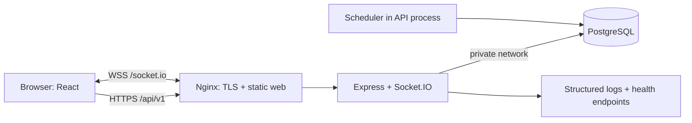

# BIDHUB — Kiến trúc codebase

## 1. Mục tiêu và phạm vi

Dự án môn Web cho nhóm 3 người, hoàn thành trong tháng 12/2026. Mục tiêu sản phẩm: người dùng tạo phiên đấu giá, trả giá, theo dõi giá trực tiếp và xem kết quả xác định bởi server. Mục tiêu portfolio của Bảo: chứng minh triển khai Linux, cấu hình mạng, HTTPS, CI, theo dõi lỗi và xử lý kết nối realtime.

MVP gồm: đăng ký/đăng nhập/đăng xuất; danh mục và tìm kiếm; xem chi tiết; tạo/sửa bản nháp; công bố phiên; trả giá; lịch sử giá; cập nhật realtime; kết thúc phiên và xác định người thắng; trang phiên của tôi/lượt trả giá của tôi; admin hủy phiên và khóa tài khoản; giao diện responsive; deploy và hướng dẫn demo.

Điểm riêng của BIDHUB: realtime + gia hạn chống trả giá sát giờ (anti-sniping) + đồng bộ trạng thái sau mất mạng. Không chỉ khác tên; phải demo được cả ba.

Ngoài MVP: thanh toán thật, ví tiền, vận chuyển, chat, email OTP, app mobile, AI gợi ý, microservices và Kubernetes. Watchlist là bổ sung nếu MVP hoàn thành sớm. Ảnh dùng dữ liệu mẫu/đường dẫn đã kiểm soát trong MVP; upload file có validation và storage riêng là việc mở rộng.

## 2. Quyết định công nghệ

- Monorepo npm workspaces: frontend, backend, contracts nằm trong một repo, một lockfile.
- Frontend: React 19 + TypeScript + Vite. Tuần 1 bổ sung React Router và TanStack Query khi xây luồng trang; tránh tự viết cache fetch.
- Backend: Node.js 24 + Express 5 + TypeScript; một ứng dụng chia module, một process phục vụ HTTP/Socket và chạy scheduler trong MVP.
- Database: PostgreSQL 17 + pg, SQL migration. Dùng SQL trực tiếp để transaction/khóa bản ghi rõ ràng; truy vấn parameterized, không nối input vào SQL.
- Realtime: Socket.IO; REST là nguồn dữ liệu chuẩn, socket chỉ cập nhật trạng thái.
- Auth dự kiến: session cookie HttpOnly, session token ngẫu nhiên lưu hash trong DB; mật khẩu Argon2id. Đạt triển khai tuần 2; không lưu token trong localStorage.
- Infra: Docker Compose cho local; Linux VPS + Nginx + HTTPS cho staging/demo. Hosting và tên miền chỉ mua khi nhóm chốt ngân sách.
- Test: Node test runner cho policy; integration test DB thật cho transaction; Playwright cho các luồng browser ở tuần 6.

Không cần Redis trong MVP một instance. Nếu chạy nhiều instance sau này, cần socket adapter và cơ chế phân phối job; không chỉ tăng replica rồi coi hệ thống đã hỗ trợ scale.

## 3. Sơ đồ runtime dự kiến



Local development chạy Vite và API riêng. Repo đã có Docker/Nginx reverse proxy, cấu hình full stack và mẫu TLS; chưa có bằng chứng triển khai HTTPS trên host thực tế.

## 4. Cấu trúc thư mục và trách nhiệm

```text
BIDHUB/
  apps/
    web/
      src/
        app/                 # Phú: router, layout, providers (planned)
        features/
          auth/              # Phú: login/register/session UI (planned)
          auctions/          # Phú: list/detail/create/my-auctions (planned)
          bids/              # Phú: form/history/result UI (planned)
          admin/             # Phú: moderation screens (planned)
        components/          # Phú: shared buttons/forms/states (planned)
        lib/                 # Phú + Bảo: API client/socket client (planned)
        main.tsx             # implemented: application shell
    api/
      src/
        config/              # Bảo: runtime configuration
        database/            # Đạt: pool + migration runner
        middleware/          # Đạt: auth, validation, errors (planned)
        modules/
          auth/              # Đạt (planned)
          users/             # Đạt (planned)
          categories/        # Đạt (planned)
          auctions/          # Đạt (planned)
          bids/              # Đạt: policy exists; HTTP/transaction planned
          admin/             # Đạt (planned)
        realtime/            # Bảo: validated rooms, publisher, after-commit helper implemented
        jobs/                # lifecycle implemented; bid/cancel integration pending
      migrations/            # Đạt; Bảo review schema/locks
  packages/contracts/        # Bảo maintains; Đạt/Phú co-review
  infra/                     # Docker/Nginx, TLS template, backup/restore scripts; host deployment pending
  docs/                      # all three; lead integrates
  .github/                   # Bảo: CI + PR template
```

Các đường dẫn ghi planned sẽ được tạo khi có implementation, không phải chức năng đang hoạt động. Module backend theo quy tắc `routes -> controller -> service -> repository`: route/middleware xác thực và parse input; controller chuyển HTTP; service chứa nghiệp vụ/transaction; repository nhận pg client và thực thi SQL. Frontend tuyệt đối không truy cập DB.

Repository của bids phải nhận cùng transaction client với auctions. Không gọi `pool.query` giữa transaction đã mở trên `client`, vì có thể rơi vào connection khác. Chỉ import chéo module qua interface service đã thống nhất; không import controller của module khác.

## 5. Mô hình dữ liệu

- `users`: email chuẩn hóa lowercase, display_name, password_hash, role MEMBER/ADMIN, disabled_at. Seller/bidder là hành vi của MEMBER, không cần hai role độc lập.
- `sessions`: hash token, user_id, expires_at; revoke khi logout/khóa tài khoản. Không log cookie/password.
- `categories`: slug/name; seed nhóm danh mục cố định, không cần admin CRUD danh mục trong MVP.
- `auctions`: seller, category, title/description/image, status, giá mở đầu/hiện tại/bước giá, starts_at/ends_at, highest_bidder, version.
- `bids`: auction, bidder, amount, idempotency_key; không sửa/xóa bid đã chấp nhận.
- `auction_results`: duy nhất một kết quả mỗi auction; winner/bid/final_price có thể cùng null nếu không có bid.
- `watchlists`: tùy chọn; schema sẵn không đồng nghĩa đã có feature.
- `audit_logs`: ai thực hiện thao tác admin, tác động đến phiên/tài khoản nào và lúc nào. Không chứa bí mật.

SQL migration ban đầu nằm trong `apps/api/migrations/001_initial.sql`. Constraint database bảo vệ kiểu/range/FK; service còn phải bảo vệ quyền sở hữu, trạng thái, matching winning bid với auction và self-bid. Migration sau khi merge phải thêm file `002_...sql`; không chỉnh lịch sử migration đã chạy trên môi trường dùng chung.

ERD đối chiếu migration, các constraint còn thiếu và đề xuất visibility cho
BH-02-A nằm tại [DB-DOMAIN.md](DB-DOMAIN.md). Fixtures mock đủ năm trạng thái
và ENDED không bid: [fixtures/README.md](fixtures/README.md). Chưa thay schema
hoặc triển khai endpoint nghiệp vụ trong phân đoạn này.

## 6. Vòng đời phiên

`DRAFT -> SCHEDULED -> ACTIVE -> ENDED`. Công bố bản nháp thành SCHEDULED nếu thời gian bắt đầu ở tương lai, ACTIVE nếu bắt đầu ngay. Scheduler kích hoạt phiên đến giờ. Admin có thể chuyển DRAFT/SCHEDULED/ACTIVE sang CANCELLED và ghi lý do. ENDED/CANCELLED là trạng thái cuối.

Seller sửa/xóa bản nháp của chính mình. Sau công bố, các trường giá/thời gian không được sửa tùy ý. Gia hạn do accepted bid là thay đổi nghiệp vụ của server. Phiên ACTIVE chỉ được nhận bid khi `starts_at <= server_now < ends_at`, kể cả scheduler chưa kịp chuyển trạng thái kết thúc. Job chạy mỗi 2–5 giây nên UI có thể ở trạng thái chờ server chốt kết quả; không tự tuyên bố thắng khi countdown về 0.

## 7. Transaction trả giá — phần bắt buộc review chung

1. Xác thực session; validate amount là chuỗi số nguyên dương và trong range BIGINT.
2. BEGIN; khóa auction bằng `SELECT ... FOR UPDATE`.
3. Đọc lại trạng thái, seller, starts/ends và giá ngay trong transaction; lấy thời gian server sau khi đã có khóa (không dùng thời gian request cũ trước khi đợi khóa).
4. Kiểm tra idempotency record. Cùng user/key/auction/amount thì trả lại kết quả trước; cùng key nhưng payload khác trả 409. Unique key ở DB là hàng rào cuối; xử lý race ở constraint và tra lại record nếu cần.
5. Chặn self-bid, user disabled, phiên chưa mở/đã hết giờ/đã hủy. Lần đầu amount >= opening price; các lần sau >= current price + minimum increment.
6. INSERT bid, UPDATE giá/highest_bidder/version; nếu còn <=30 giây thì ends_at = max(ends_at, now + 60 giây).
7. COMMIT. Chỉ sau commit emit `auction:updated`. Nếu rollback tuyệt đối không phát thông báo accepted.
8. HTTP trả trạng thái đã commit. Socket bị mất không làm mất bid; client lấy snapshot REST và retry với cùng idempotency key.

Job kết thúc phải khóa cùng auction row, kiểm tra lại ends_at sau khóa (vì bid có thể gia hạn), insert result một lần rồi UPDATE status/version. Scheduler phải quét cả phiên quá hạn sau restart; không chỉ dùng setTimeout trong RAM.

Rủi ro đã biết: process crash sau commit trước emit. MVP giải quyết bằng REST resync khi reconnect/focus và polling 15 giây khi đang mở chi tiết; outbox event là mở rộng. Không cam kết socket exactly-once.

## 8. Quyền và bảo mật

Khách xem phiên công khai. MEMBER tạo phiên/trả giá/watchlist; chỉ chủ phiên sửa draft. ADMIN hủy phiên/khóa tài khoản; role lấy từ DB, không từ body. Tất cả state-changing request yêu cầu kiểm tra Origin/CSRF token; cookie Secure trong HTTPS, HttpOnly, SameSite=Lax. Local dùng Vite proxy cùng origin.

Đạt thêm schema validation, Argon2id và rate limit tuần 2. Bảo cấu hình trusted proxy đúng số hop tuần 6, không bật trust proxy vô điều kiện. Rate limit login và bid theo session/IP; giới hạn body; tránh log dữ liệu nhạy cảm. CORS không thay thế auth/CSRF.

Ảnh URL dùng mẫu hoặc allowlist HTTPS; không để server tải URL tùy ý. Database không mở cổng public. Secret qua biến môi trường/GitHub Secrets; `.env` không commit. Admin account tạo qua seed/operator, không có endpoint tự đăng ký ADMIN.

## 9. Chất lượng và tiêu chí kiến trúc

PR phải có typecheck/test/build và chứng cứ scenario; contract/schema thay đổi cần người bị ảnh hưởng review. Test policy hiện có chưa chứng minh chống race; chỉ integration test PostgreSQL với requests cạnh tranh mới chứng minh điều đó. Bảo chịu trách nhiệm duyệt phần tích hợp; không tự gánh mọi feature.

Tài liệu tham khảo thiết kế: [PostgreSQL row locking](https://www.postgresql.org/docs/17/explicit-locking.html), [Socket.IO delivery guarantees](https://socket.io/docs/v4/delivery-guarantees/), [Vite requirements](https://vite.dev/guide/). Những nguồn này mô tả hành vi công nghệ; các quy tắc giá/gia hạn là quyết định riêng của nhóm BIDHUB.
