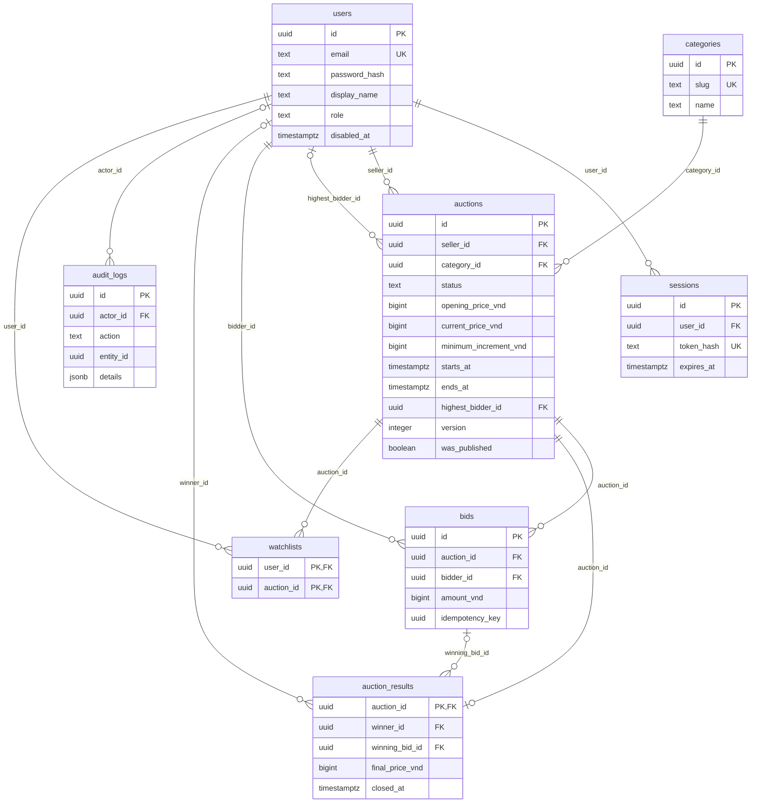

# BH-02-A — ERD và rules cơ sở

Ngày đối chiếu: 25/11/2026, dựa trên main `260053b`, migrations 001–003 và
types `packages/contracts/src/index.ts`. Tài liệu ghi lại hành vi code đã có;
fixtures vẫn là mock. Kết quả chạy test được ghi riêng trong
[bằng chứng nghiệm thu](ACCEPTANCE-2026-11-25.md). Review nghiệp vụ của ba
thành viên vẫn cần được xác nhận, không suy ra từ việc test pass.

## Đối chiếu code tích hợp

Main có HTTP auth, auction reads, draft/publish, bid transaction, admin,
personal bids, `processAuctionLifecycle` (activate/close/catch-up), runner và
`withTransaction` với callbacks sau commit. Bid, cancel và lifecycle dùng
row lock trước khi đổi auction; session/disable khóa user theo thứ tự ổn định.
Test nằm tại `modules/bids/bid-service.test.ts`, `modules/admin/routes.test.ts`,
`jobs/auction-lifecycle.test.ts` trong `apps/api/src/`.

REST và Socket.IO dùng chung quy tắc đọc công khai trong nhánh MVP. Migration
003 thêm `auctions.was_published`. Các phiên SCHEDULED/ACTIVE/ENDED hiện hữu
được đánh dấu đã công bố. CANCELLED cũ thiếu chứng cứ công bố được giữ riêng.

## ERD theo schema hiện có

Sơ đồ liệt kê các cột quan hệ/nghiệp vụ chính; title, description, image_url
và created_at xem SQL. `audit_logs.entity_id` không có FK đa hình.
`watchlists` có schema nhưng nằm ngoài MVP của phân đoạn này.
ERD thể hiện constraint hiện tại: một bid có thể được nhiều result tham chiếu;
DB chưa có composite FK đảm bảo bid thuộc đúng auction/winner. Lifecycle hiện
chọn bid của chính auction và ghi result trong transaction; SQL ghi ngoài
service vẫn có thể vi phạm quan hệ này.

## DB bảo vệ gì, service còn phải bảo vệ gì

| Dữ liệu | Constraint hiện có | Invariant do service bảo vệ (cần giữ regression) |
|---|---|---|
| Users | email unique; role MEMBER/ADMIN | Chuẩn hóa lowercase, validate email; không nhận role từ register body; disabled lấy DB |
| Sessions | user FK; token_hash unique; expiry bắt buộc | Token ngẫu nhiên lưu hash, hết hạn/revoke, disable revoke sessions; không trả token_hash |
| Auctions | seller/category FK; 5 statuses; opening/increment > 0; current >= opening; end > start | Owner, lifecycle, self-bid, start/deadline, highest bidder khớp bid, version tăng khi state đổi |
| Bids | user/auction FK; amount > 0; unique `(bidder_id,idempotency_key)` | Key dùng trên toàn user, conflict nếu đổi auction/amount; bid bất biến; amount/current nhất quán |
| Results | auction PK/FK; winner/bid FK; check bộ null hoặc winner/bid có giá > 0 | ENDED duy nhất một result; bid thuộc auction/winner; final bằng winning amount; cancelled không có winner |
| Audit | actor FK nullable; details JSONB | Reason và thao tác admin cùng transaction; không chứa secrets |

Migration `002_result_integrity.sql` đã bổ sung CHECK buộc bộ winner/bid/price
cùng null hoặc đủ ba giá trị với giá dương; version có CHECK >= 0.
Migration 001 được giữ nguyên. Quyền owner, start/deadline, self-bid và
disabled account được kiểm tra tại service, không phải SQL CHECK. Test
migration/negative constraints: `database/migrations.test.ts`; test nghiệp vụ:
`modules/auctions/write.test.ts`, `modules/bids/bid-service.test.ts`.
Indexes hiện có: listing `(status,ends_at)`, seller `(seller_id,created_at)`,
history `(auction_id,created_at DESC,id)`, sessions `(expires_at)`.

## Rules đã có trong thiết kế nhóm

- MEMBER là seller/bidder theo hành vi; ADMIN chỉ được cấp qua seed/operator.
- Owner sửa/xóa DRAFT; publish sang SCHEDULED khi start ở tương lai hoặc ACTIVE
  khi start đã đến. Draft có thể lưu thời gian đã qua để chỉnh sau. Publish
  yêu cầu end còn trong tương lai, đánh dấu `was_published` và tăng version
  trong cùng transaction. SCHEDULED → ACTIVE → ENDED; catch-up xử lý phiên quá hạn.
- Admin hủy DRAFT/SCHEDULED/ACTIVE với reason/audit; ENDED/CANCELLED là trạng thái cuối.
- Giá integer VND dương trong signed BIGINT (`1..9223372036854775807`), payload
  string chữ số; không dùng Number để tính giá. Kiểm tra cả phép cộng bước giá.
- API time UTC ISO 8601, DB timestamptz. Bid chỉ khi ACTIVE và
  `starts_at <= server_now < ends_at`, sau khi khóa row mới lấy thời gian.
- First bid >= opening; next >= current + increment; không self-bid/disabled.
  Không bid thì current = opening nhưng result finalPriceVnd = null.
- Accepted bid trong <=30s cuối đảm bảo >=60s còn lại; bid/close dùng cùng row
  lock và transaction client. Version và snapshot chỉ phát sau commit.
- Result không bid: winner/winning bid/final price cùng null. Countdown hết
  chưa đồng nghĩa result sẵn sàng; server chốt mới có kết quả.

## Visibility đã triển khai, chờ nhóm xác nhận chính sách

List/detail/history/result, socket join, personal routes và admin routes đã
triển khai theo ma trận. Admin lookup riêng chỉ trả metadata để kiểm duyệt;
role ADMIN không tự mở quyền đọc detail riêng hoặc sửa draft của người khác.

| Luồng | Guest / member khác | Owner | ADMIN |
|---|---|---|---|
| Public list/detail/history/socket join | SCHEDULED/ACTIVE/ENDED và CANCELLED từng công bố | Cùng quyền public | Cùng quyền public |
| DRAFT hoặc CANCELLED chưa công bố | Không hiện list; detail/history/join trả 404 | Detail riêng; không phát room public | Detail/history/join như public; lookup moderation riêng trả id/title/status |
| `/me/auctions` | Guest 401; member chỉ phiên của mình | Tất cả trạng thái của mình | Chỉ phiên của mình; không ngầm mở admin search |
| `/me/bids` | Guest 401; member chỉ bids của mình | Không nhận bidderId từ client | Chỉ bids của mình |
| Write draft/publish | Guest 401; member khác 403 | Owner được thao tác theo trạng thái | Không mặc nhiên được sửa draft người khác |
| Admin cancel/disable | Guest 401; MEMBER 403 | MEMBER vẫn 403 | Role từ DB, CSRF/Origin, reason/audit |

Payload public giữ seller `{id,displayName}` và history `bidderDisplayName`;
không email, IP, password/token hash hay idempotency key. Auth trả email chỉ cho
chính current user. Socket phải dùng cùng visibility với REST.

Dấu `was_published` là boolean vì dữ liệu cũ thiếu thời điểm công bố chính xác.
Cancel giữ dấu này và đánh dấu true khi trạng thái trước hủy
là SCHEDULED/ACTIVE. Không suy từ version hoặc starts_at.

## Lựa chọn đã triển khai cần review

| Quyết định | Người cần review | Hạn / phần bị chặn |
|---|---|---|
| Visibility, `was_published`, ADMIN đọc draft | Bảo + Phú + Đạt | Review chính sách của nhánh MVP trước tích hợp |
| Sort và payload list item | Phú + Đạt, Bảo types | Review payload nhánh MVP với frontend |
| CSRF bootstrap, cookie/session expiry/hash, input/rate limits | Bảo + Phú + Đạt | Review chính sách auth của nhánh MVP |
| Publish thời gian đã qua, publish lặp, writable fields | Phú + Đạt | Review chính sách draft/publish của nhánh MVP |
| Replay trả bidId cũ và snapshot mới nhất, không phát thêm event; user lock trước auction lock | Bảo + Đạt, Phú consumer | Review service và test replay/concurrency BH-11/BH-19 |
| Activate/close phát sau commit; result CANCELLED trả 409 AUCTION_CANCELLED; chặn disable admin cuối | Bảo + Phú + Đạt | Review lifecycle/admin và test BH-14/BH-15 |

BH-02 chưa được ghi Done chỉ từ lần đối chiếu này. Bảo, Phú và Đạt cần ghi
tên/ngày/xác nhận hoặc vấn đề cần sửa trong checklist nghiệm thu; agent không
điền xác nhận thay thành viên.
