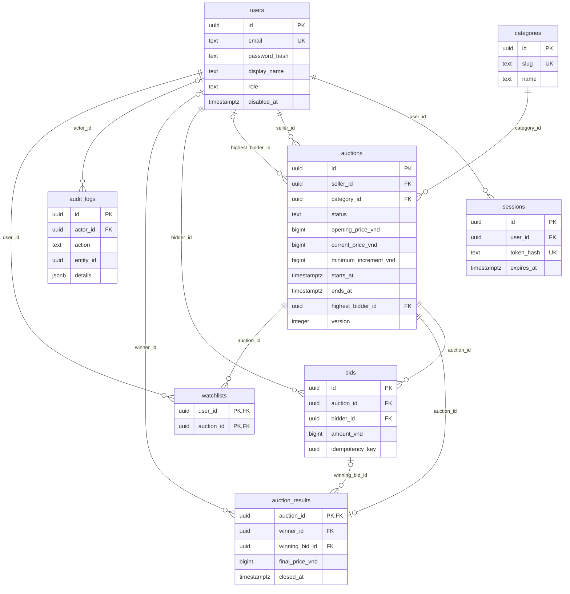

# BH-02-A — ERD và rules cơ sở

Ngày đối chiếu: 22/10/2026. Main `3439b9b`, migration
`apps/api/migrations/001_initial.sql`, types `packages/contracts/src/index.ts`.
Đây là thiết kế và dữ liệu mock để review, không phải bằng chứng API/DB đã chạy.

## Đối chiếu code tích hợp

Main đã có `processAuctionLifecycle` (activate/close/catch-up), runner và
`withTransaction` với callbacks sau commit. Phần Đạt cần tái sử dụng các seam
này, review nghiệp vụ và test cạnh tranh cùng bid/cancel service khi có;
không xây scheduler song song. Shared `AuctionSnapshot` và migration 001
vẫn khớp fixtures/ERD bên dưới. API auth/auction/bid nghiệp vụ chưa có.

Socket room hiện cho đọc mọi auction có status khác DRAFT. Điều này chưa
phân biệt CANCELLED từ draft với CANCELLED từng public; ma trận visibility
bên dưới là đề xuất chưa tích hợp, không mô tả quyền runtime đã bảo vệ đủ.
Khi quyết định visibility được review, cần phối hợp Bảo áp dụng cùng REST.

## ERD theo schema hiện có

Sơ đồ liệt kê các cột quan hệ/nghiệp vụ chính; title, description, image_url
và created_at xem SQL. `audit_logs.entity_id` không có FK đa hình.
`watchlists` có schema nhưng nằm ngoài MVP của phân đoạn này.
ERD thể hiện constraint hiện tại: một bid có thể được nhiều result tham chiếu;
service tương lai phải chặn result trỏ bid của auction khác.

## DB bảo vệ gì, service còn phải bảo vệ gì

| Dữ liệu | Constraint hiện có | Invariant cần implementation/tests ở task sau |
|---|---|---|
| Users | email unique; role MEMBER/ADMIN | Chuẩn hóa lowercase, validate email; không nhận role từ register body; disabled lấy DB |
| Sessions | user FK; token_hash unique; expiry bắt buộc | Token ngẫu nhiên lưu hash, hết hạn/revoke, disable revoke sessions; không trả token_hash |
| Auctions | seller/category FK; 5 statuses; opening/increment > 0; current >= opening; end > start | Owner, lifecycle, self-bid, start/deadline, highest bidder khớp bid, version tăng khi state đổi |
| Bids | user/auction FK; amount > 0; unique `(bidder_id,idempotency_key)` | Key dùng trên toàn user, conflict nếu đổi auction/amount; bid bất biến; amount/current nhất quán |
| Results | auction PK/FK; winner/bid FK; check bộ null hoặc winner/bid có giá > 0 | ENDED duy nhất một result; bid thuộc auction/winner; final bằng winning amount; cancelled không có winner |
| Audit | actor FK nullable; details JSONB | Reason và thao tác admin cùng transaction; không chứa secrets |

Lưu ý SQL: nhánh có winner của CHECK result hiện cho phép `final_price_vnd`
NULL do CHECK chấp nhận UNKNOWN. Không coi constraint này đã bảo vệ bộ ba đầy
đủ; BH-03-A cần migration bổ sung và test negative. Không sửa migration 001.
Version chưa có CHECK nonnegative; starts_at và disabled chưa được policy hiện
tại kiểm tra. Đây là khoảng trống implementation, không phải rule được bỏ qua.
Indexes hiện có: listing `(status,ends_at)`, seller `(seller_id,created_at)`,
history `(auction_id,created_at DESC,id)`, sessions `(expires_at)`.

## Rules đã có trong thiết kế nhóm

- MEMBER là seller/bidder theo hành vi; ADMIN chỉ được cấp qua seed/operator.
- Owner sửa/xóa DRAFT; publish sang SCHEDULED khi start ở tương lai hoặc ACTIVE
  khi bắt đầu ngay. SCHEDULED → ACTIVE → ENDED; catch-up phải xử lý phiên quá hạn.
- Admin hủy DRAFT/SCHEDULED/ACTIVE với reason/audit; ENDED/CANCELLED là trạng thái cuối.
- Giá integer VND dương trong signed BIGINT (`1..9223372036854775807`), payload
  string chữ số; không dùng Number để tính giá. Kiểm tra cả phép cộng bước giá.
- API time UTC ISO 8601, DB timestamptz. Bid chỉ khi ACTIVE và
  `starts_at <= server_now < ends_at`, sau khi khóa row mới lấy thời gian.
- First bid >= opening; next >= current + increment; không self-bid/disabled.
  Không bid thì current = opening nhưng result finalPriceVnd = null.
- Accepted bid trong <=30s cuối đảm bảo >=60s còn lại; bid/close dùng cùng row
  lock và transaction client. Version và snapshot chỉ phát sau commit.
- Result không bid: winner/winning bid/final price cùng null. Countdown hết
  chưa đồng nghĩa result sẵn sàng; server chốt mới có kết quả.

## Visibility đề xuất — chờ Bảo/Phú review trước BH-07/BH-09

Thiết kế nhóm mới chốt guest đọc public và owner sửa draft. Ma trận sau làm rõ
đề xuất cho phần còn thiếu, chưa thay đổi endpoint/types hoặc được human duyệt.

| Luồng | Guest / member khác | Owner | ADMIN |
|---|---|---|---|
| Public list/detail/history/socket join | SCHEDULED/ACTIVE/ENDED và CANCELLED từng công bố | Cùng quyền public | Cùng quyền public |
| DRAFT hoặc CANCELLED chưa công bố | Không hiện list; detail/history/join trả 404 | Detail riêng; không phát room public | Cần chốt quyền đọc moderation |
| `/me/auctions` | Guest 401; member chỉ phiên của mình | Tất cả trạng thái của mình | Chỉ phiên của mình; không ngầm mở admin search |
| `/me/bids` | Guest 401; member chỉ bids của mình | Không nhận bidderId từ client | Chỉ bids của mình |
| Write draft/publish | Guest 401; member khác 403 | Owner được thao tác theo trạng thái | Không mặc nhiên được sửa draft người khác |
| Admin cancel/disable | Guest 401; MEMBER 403 | MEMBER vẫn 403 | Role từ DB, CSRF/Origin, reason/audit |

Payload public giữ seller `{id,displayName}` và history `bidderDisplayName`;
không email, IP, password/token hash hay idempotency key. Auth trả email chỉ cho
chính current user. Socket phải dùng cùng visibility với REST.

**Blocker thiết kế:** schema chưa có dấu mốc published để phân biệt CANCELLED
từ DRAFT và từ phiên public. Không dùng version/starts_at để đoán. Trước
BH-03-A/BH-07 phải review lựa chọn thêm `published_at` bằng migration mới hoặc
chốt visibility CANCELLED khác; phân đoạn này không tự thêm field.

## Quyết định mở và hạn chốt

| Quyết định | Người cần review | Hạn / phần bị chặn |
|---|---|---|
| Visibility ở trên, published marker, ADMIN đọc draft | Bảo + Phú + Đạt | Trước schema bổ sung/read API BH-03-A/BH-07 |
| Sort whitelist/default ổn định và payload list item | Phú + Đạt, Bảo types | Trước BH-07-A; fixture detail không tự coi là list item |
| Anonymous CSRF bootstrap, cookie/session expiry/hash, input/rate limits | Bảo + Phú + Đạt | Trước BH-04; auth hiện vẫn planned |
| Publish thời gian đã qua, publish lặp, writable fields | Phú + Đạt | Trước BH-09 |
| Replay snapshot ban đầu hay mới nhất; lock order bid/disable/cancel | Bảo + Đạt, Phú consumer | Trước BH-11; key/bidId semantics giữ contract hiện có |
| Activate/close committed interface, cancelled result response, last-admin guard | Bảo + Phú + Đạt | Trước BH-14/BH-15 |

BH-02-A bàn giao đề xuất và ví dụ để review. Chưa có phản hồi của Bảo/Phú;
không đánh dấu BH-02 toàn nhóm Done hoặc cho phép code phụ thuộc quyết định mở.
